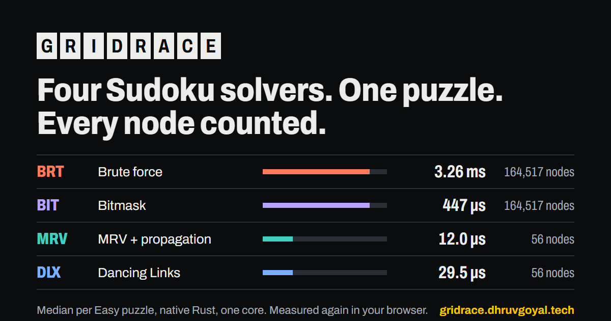

# GridRace

[](https://github.com/DhruvGoyal404/gridrace/actions/workflows/ci.yml)
[](LICENSE)

**Four Sudoku solvers race on the same puzzle, with every node counted.** Brute force,
bitmask, MRV with constraint propagation, and Dancing Links, written in Rust, compiled to
WebAssembly, each running in its own Web Worker in your browser. Replay any solver's
search step by step, play with hints that explain *why* a digit is forced, and generate
puzzles that are guaranteed to have exactly one solution.

**Live:** https://gridrace.dhruvgoyal.tech (works offline once loaded; no server, no
accounts, no tracking).



## In one minute

- **A smaller tree beats a faster check.** Bitmask makes each legality check O(1) and runs
  5 to 7 times faster than brute force while visiting *exactly* the same nodes. MRV with
  propagation visits 56 nodes where brute force visits 164,517: three orders of magnitude.
- **The general algorithm isn't the fastest here, and I measured why.** Dancing Links
  visits as many nodes as MRV but takes 1.7 to 2.5 times longer on graded puzzles.
  Profiling showed 40% of its time was matrix setup, not the search; two changes cut
  that, and on the hardest puzzles its median is now 1.24× MRV's.
- **Human difficulty is not search difficulty.** Grading puzzles by the techniques a
  person needs, MRV's work only rises from 56 to 103 nodes between the Easy and Beyond
  tiers, and brute force is slowest on the *Easy* tier. Benchmarks need puzzles built
  against the solvers, so this repo builds them.
- **Every number is reproducible.** The puzzle corpus is generated by this repo, CI
  checks it, and the benchmark method (pinned core, percentiles, caveats) is written
  down in [docs/BENCHMARKS.md](docs/BENCHMARKS.md).

## The four solvers

All four count the same things, defined once in [search.rs](crates/core/src/search.rs):
**nodes** (placements tried), **backtracks** (guesses undone) and **checks** (questions
of the form "can this digit go here?"). What a check costs is where they differ. *m* is
the number of empty cells; generalised Sudoku is NP-complete, so every solver is
exponential in the worst case, and the differences are the size of the tree and the
cost of each node.

| Solver | Idea | Worst-case nodes | Cost per node |
|---|---|---|---|
| [Brute force](crates/core/src/solvers/brute.rs) | First empty cell, try 1 to 9, scan the cell's row, column and box for each digit, backtrack on a dead end | O(9^m) | 9 digits × 27 cell reads |
| [Bitmask](crates/core/src/solvers/bitmask.rs) | The same search; a 9-bit mask per row, column and box gives every legal digit as `!(row \| col \| box)` | O(9^m), the identical tree | O(1) |
| [MRV + propagation](crates/core/src/solvers/mrv.rs) | After each guess, place naked and hidden singles until nothing changes, then branch on the cell with the fewest candidates | O(9^m), far smaller in practice | One propagation fixpoint, O(81 + 27·9) per pass |
| [Dancing Links](crates/core/src/solvers/dlx.rs) | Knuth's Algorithm X on Sudoku as exact cover: 729 placements × 324 constraints; cover and uncover are O(1) pointer splices | O(9^m) | O(columns) to pick the smallest, O(1) per link touched |

### Measured

Median time per solve over 100 Easy puzzles and over the 50 puzzles built to be hardest
for the smart solvers (mean nodes in brackets):

| Solver | Easy, native | Easy, browser | Hardest, native | Hardest, browser |
|---|---:|---:|---:|---:|
| Brute force | 3.26 ms (164,517) | 1.49 ms | 8.99 ms (194,314) | 5.01 ms |
| Bitmask | 447 µs (164,517) | 455 µs | 1.25 ms (194,314) | 1.29 ms |
| MRV + propagation | 12.0 µs (56) | 15.2 µs | 220 µs (701) | 204 µs |
| Dancing Links | 29.5 µs (56) | 15.8 µs | 272 µs (799) | 199 µs |

*Native*: Rust, `cargo bench`, the fastest of 3 to 5 single solves, pinned to one
performance core of an i5-1235U laptop. *Browser*: the same code as WebAssembly on the
app's Bench page in Chromium, each puzzle repeated until the batch takes 10 ms, then
averaged. **The two columns are not a like-for-like race**: the browser's batching warms
caches and amortises allocation, and its run wasn't pinned. They agree on the shape (the
same gaps between solvers, WebAssembly within 0.45× to 1.3× of native), not on a winner.
Every tier, p95, max and the method are in [docs/BENCHMARKS.md](docs/BENCHMARKS.md).

### What each step teaches

- **Brute force → bitmask: cheaper checks, same tree.** A test asserts the two visit
  identical nodes; only the cost of "is this digit legal?" changes, from a 27-cell scan
  per digit to one mask operation per cell.
- **Bitmask → MRV: a smaller tree.** Propagation fills most cells without guessing, and
  branching where the fewest candidates remain keeps the branching factor near 2.
- **MRV → Dancing Links: the general method.** Algorithm X's "column with fewest rows"
  is MRV and hidden singles in one rule, and the same couple of hundred lines solve any exact-cover
  problem. On easy puzzles propagation settles cells for free while DLX pays pointer work
  per node; when the search gets hard the gap closes.
  [The profiling and the two fixes](docs/BENCHMARKS.md#dlx-tuning-2026-11-12) are
  recorded with before/after ratios from the same session.
- **Digit order is brute force's weakness.** Relabelling a puzzle so its first row reads
  `987654321` makes every first guess wrong: brute force's median grows 66 to 97 times;
  MRV and DLX don't notice.

## Hints that explain why

[human.rs](crates/core/src/human.rs) solves the way a person does: pencil marks, then the
easiest technique that makes progress. Seventeen techniques, ordered by Sudoku
Explainer's difficulty ratings, read from its source and cited in the file:

| Rating | Technique | Rating | Technique |
|---:|---|---:|---|
| 1.2 / 1.5 | Hidden single | 4.0 | Skyscraper |
| 2.3 | Naked single | 4.1 | 2-String Kite |
| 2.6 | Pointing | - | W-Wing (placed by HoDoKu's order) |
| 2.8 | Box-line reduction | 4.2 | XY-Wing |
| 3.0 | Naked pair | 4.5 | Unique rectangle |
| 3.2 | X-Wing | 6.6+ | X-Chain |
| 3.4 | Hidden pair | 7.0+ | XY-Chain |
| 3.6 / 3.8 / 4.0 | Naked triple, Swordfish, Hidden triple | | |

A hint climbs a ladder, revealing as little as needed: the technique, then where to look,
then the full reasoning with the pattern highlighted, then the move. The reasoning is
written out, for example:

> X-Chain on 7: If r1c1 isn't 7, r1c5 is (the only other 7 in row 1), so r4c5 isn't (it
> sees r1c5), r4c9 is (the only other 7 in row 4), so r8c9 isn't (it sees r4c9), r8c2 is
> (the only other 7 in row 8). So r1c1 or r8c2 is 7, and this removes 7 from r2c2, r3c2,
> r7c1 and r9c1.

Before any of that, a hint checks for clashing digits, whether the puzzle has exactly one
solution, and entries that disagree with it. Deductions the next placement doesn't need
are pruned, chains are found breadth-first so the shortest one is shown, and when no
technique applies the hint says so and reveals one cell. Property tests over hundreds of
puzzles check that **no step ever contradicts the solution**, and the fuzzer checks the
same on arbitrary input.

## Puzzles with exactly one solution

[generate.rs](crates/core/src/generate.rs) fills a random grid, then empties cells in
random order, keeping each removal only if the puzzle still has exactly one solution
(Dancing Links counts solutions and stops at two). Every clue left is necessary, so each
puzzle is minimal. Difficulty is the hardest technique an easiest-first solve needs, not
the number of empty cells. Over 20,000 generated puzzles: Easy 41.5%, Medium 11.9%, Hard
6.5%, Expert 16.2%, Master (chains) 7.9%, Beyond 15.9%. Adding the chain and uniqueness
techniques cut Beyond, where a hint can only reveal a cell, from 35.1%. A seed names a
puzzle forever: the PRNG is a ten-line SplitMix64, identical on every platform.

## How it's built

```
crates/core   Rust, zero dependencies: grid, 4 solvers, traces, human solver, generator
crates/wasm   wasm-bindgen bindings: JSON results, byte traces, validated input
web/          React + TypeScript + Vite + Tailwind; one Web Worker per solver in a race
data/         benchmark corpus, generated by crates/core/examples/corpus.rs
```

- The core never touches a clock, threads or I/O, so it builds for
  `wasm32-unknown-unknown`; the worker times each solve with `performance.now()`, made
  precise by cross-origin isolation.
- Traces are capped (the replay says when) and every search has a node limit (brute
  force says "gave up" instead of freezing a tab).
- A service worker precaches the build, so the race, Play and Bench work offline.

## Quality

- **Rust:** unit tests per solver; seeded property tests (every solution valid, all four
  solvers agree on the solution count, traces replay to the solution, brute force and
  bitmask visit identical trees); a hand-built board per technique; libFuzzer on parsing,
  solving, grading and hinting; Clippy pedantic; cargo-deny.
- **Web:** Vitest; Playwright end-to-end on desktop and a 390 px phone (race, replay,
  generate, paste, keyboard play, hints all the way to a solved board, offline), axe
  (WCAG 2.1 AA) in both themes, any console error fails a test, all under the
  production Content Security Policy.
- **Supply chain:** every crate, npm package, toolchain and GitHub Action at least 14
  days old, pinned exactly, actions by commit SHA, lockfiles audited, gitleaks on the
  full history.

## Run it

Rust 1.99.1 (pinned in [rust-toolchain.toml](rust-toolchain.toml)), Node 24, and
`cargo install wasm-bindgen-cli --version 0.2.129 --locked`.

```sh
cargo test                                   # Rust unit, property and doc tests
cargo bench                                  # native medians per tier
cd web && npm ci && npm run wasm && npm run dev   # the app on localhost:5173
bash scripts/gate.sh                         # everything CI runs
```

## Hosting

A static site on Cloudflare Pages, deployed from GitHub Actions with an API token scoped
to Pages only. Nothing bills while it sits idle (free tier, no servers, no databases), so
unlike my other deployed projects it has no up/down scripts.

## License

[MIT](LICENSE). The benchmark puzzles are generated by this repository and share its
licence.
